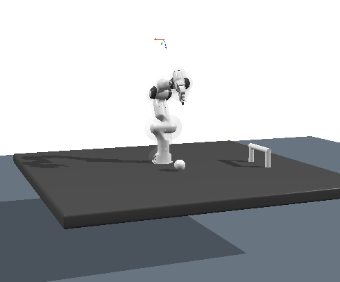

# Exercise 3: Non-prehensile and Multi-Contact Manipulation

This week you will continue to program the robot to execute simple manipulations.  
The focus now shifts from grasping in week 1 to **non-prehensile manipulation**:

> **Non-prehensile manipulation** refers to moving or controlling objects without grasping them, typically by pushing, sliding, rolling, or using contact with the environment.

In this exercise, your task is to **shoot a ball into a target** (see image below).
For more information you can for instance read the introduction of [this PhD thesis](https://www.ri.cmu.edu/pub_files/pub1/lynch_kevin_1996_1/lynch_kevin_1996_1.pdf).



---

## Learning Goals

By completing this exercise, you will learn to:

- Use a simple **physics simulator** via the provided `SimWrapper` class.
- Formulate a **trajectory optimization** problem in KOMO for a pushing task.
- (Bonus) Generalize your solution to different ball initial positions.

---

## Files Provided

You are given:

- `assets/cfg0.g` —scene configuration (robot, table, ball, target posts).
- `assets/ball_shot.npy` —precomputed solution from the previous exercise.
- `assets/scene.png` —visual reference of the setup.
- Python starter code, including:
  - `SimWrapper` for handling simulation
  - `straight_push(cfg)` to implement
  - `main(args)` for running optimization, simulation, and optional robot execution

---

## Running the Script

The script supports:

```
--sim-only     # Only run simulation using precomputed trajectory
--botop        # Also run trajectory on BotOp
--real         # Use the real robot (must be used with --botop)
```

Examples:

```
# 1) Test simulation rollout with the precomputed solution:
python exercise3.py --sim-only

# 2) Run your optimized pushing motion:
python exercise3.py

# 3) Run on BotOp (if available):
python exercise3.py --botop
python exercise3.py --botop --real
```

---


## 1.1 Simulation Setup & Trajectory Rollout [3 points]

The pushing task requires resoning about the motions of the robot, but also those of the environment (the ball in this case).
The normal KOMO trajectory optimizer cannot do that. Hence you will need a simulator to test your trajectories.
While `botop` also provides simulation logic, it is realtime which is not desirable for many usecases where you want to evaluate a trajectory as quickly as possible.
Therefore you will finish the implementation of a small wrapper of the `ry.Simulator` class, so you can evaluate your trajectories with

```python
SimWrapper.run_trajectory(self, path, n_phases)
```

This method must:

1. Convert the list of joint configurations (`path`) into a **spline reference** using `set_spline_ref`.
2. Step the simulator long enough for the entire trajectory to play out.
3. Use **spline control mode** when calling `step`.

After implementing this, run:

```
python exercise3.py --sim-only
```

You should see the robot perform the precomputed 'shot'. Note how the displayed result differs from `komo.view_play`.

---

## 1.2 Straight-Line Push: Implement Trajectory Optimization [7 points]

Given your simulation you should now program a pushing motion that will reproduce the shot that you loaded from a file in 1.1.


Using
```python
def straight_push(cfg: ry.Config) -> ry.KOMO:
```

you will construct a **KOMO trajectory optimization problem** that pushes the ball from its starting position into the goal region.

A high-level strategy (concept only; do not copy from this description):

1. **Determine a target point**:  
   Use the two goal-post frames (`post1`, `post2`) to compute a target between them.

2. **Define a push line**:  
   Use the ball’s current position and the computed target to form a straight line on the table.

3. **Choose robot waypoints** along this line:  
   - An **approach pose** above the ball  
   - A **start contact pose** behind the ball  
   - An **end contact pose** further down the push line  

4. **Formulate KOMO objectives** such as:  
   - Timing and smoothness  
   - Joint limits and collision avoidance  
   - Orientation so the gripper stays aligned with the push direction  
   - Position objectives for approach, start, and end poses  
   - Constraints to keep motion close to the push line  

Your numerical choices are flexible; any solution that yields a feasible straight push is valid.

When implemented correctly, running:

```
python exercise3.py
```

will:

1. solve the optimization,  
2. show the result in the KOMO viewer,  
3. simulate the push,  
4. optionally execute it on the robot.

---

## 1.3 Bonus: Generalize to Arbitrary Ball Starting Positions [+3 points]

Currently the ball starts near `(0.0, 0.2)`.  
For the bonus task, extend your logic so it also works when the ball starts somewhere else, e.g. `(-0.2, 0.1)`.

Hints:

- Always compute the push direction from the **actual** ball position in the config, you can simply overwrite this for the bonus.
- Compute approach/start/end waypoints based on that direction.

---

