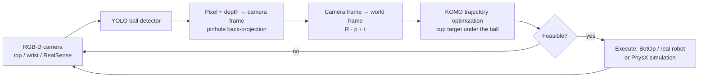

# Gravity Panda 🐼☕

**A Franka Emika Panda arm that tries to catch a ball in a cup it is holding, using a YOLO-based vision pipeline and KOMO motion optimization.**

The robot picks up a cup, watches the scene through an RGB-D camera, detects the ball, projects the detection into 3D world coordinates and plans a joint-space trajectory that brings the cup under the ball. The same code runs in a PhysX simulation, on the BotOp robot interface and on the real robot.


---

## Contents

- [How it works](#how-it-works)
- [Repository structure](#repository-structure)
- [Installation](#installation)
- [Usage](#usage)
- [Command-line arguments](#command-line-arguments)
- [Configuration](#configuration)
- [Limitations and next steps](#limitations-and-next-steps)
- [Authors](#authors)

---

## How it works



**1. Scene setup** (`simulation/scene_builder.py`)
Loads the `pandaSingle` scenario from `robotic`, adds the camera, ball and obstacles from `config/config_gp.g`, and attaches a cylindrical cup to the left finger with the correct orientation (quaternion composition). A preview window opens before anything moves; press `q` to abort.

**2. Perception** (`camera/`, `object_detector/`)
- Frames come from either the simulated/BotOp cameras (`cameraTopMiddle`, `cameraWrist`) or a standalone Intel RealSense (1280×720 color + depth at 30 FPS).
- A custom-trained YOLO model (`yolo/ball_with_aruco_n.pt`) detects the ball; the bounding-box center is taken as the ball pixel.
- The pixel is back-projected with the camera intrinsics `K` and the depth value, then transformed into the world frame with the camera's pose.

**3. Motion planning** (`motion/komo_planner.py`)
KOMO sets up a constrained optimization problem for the gripper:
- penalizes acceleration, velocity and joint-motion magnitude
- enforces joint limits and collision avoidance as hard constraints
- fixes the end-effector orientation so the cup opening points upwards
- places the end effector at a target derived from the ball position (offset by the cup size, with a minimum safe height above the table)

The problem is solved with `ry.NLP_Solver`. Infeasible solutions are skipped and the loop continues with the next frame.

**4. Execution** (`main.py`, `simulation/sim_wrapper.py`)
Feasible paths are sent to `BotOp` (simulation or real robot) or rolled out as spline references in a PhysX simulation.

**5. Safe shutdown**
`Ctrl+C` is caught by a custom SIGINT handler: the robot puts the cup back on the table, opens the gripper, returns to its home configuration and closes the camera before the program exits.

---

## Repository structure

```
gravity-panda/
├── main.py                    # Entry point: perception → planning → execution loop
├── pyproject.toml             # Dependencies (uv / pip)
├── config/
│   ├── config_gp.g            # Scene: top camera, ball, tower obstacle
│   └── config_scene_3.g       # Scene used by an earlier exercise
├── camera/
│   ├── bot_camera.py          # Cameras of the robotic/BotOp setup (top, wrist)
│   ├── real_sense.py          # Standalone Intel RealSense wrapper
│   └── video_recorder.py      # Records camera streams to auto-numbered video files
├── object_detector/
│   ├── yolo_detector.py       # YOLO ball detection + 2D → 3D world projection
│   └── aruco_detector.py      # ArUco marker pose estimation (calibration / experiments)
├── motion/
│   └── komo_planner.py        # KOMO problem setup and NLP solving
├── simulation/
│   ├── scene_builder.py       # Builds the ry.Config and attaches the cup
│   └── sim_wrapper.py         # Thin wrapper around ry.Simulation (PhysX)
├── yolo/
│   ├── ball_with_aruco_n.pt   # Default ball detector weights
│   └── blue_exclusive.pt      # Alternative model trained on a blue ball only
├── tests/
│   └── test_camera.py         # Manual check of the camera feed
└── prev_exercises/            # Earlier exercises this project builds on
```

---

## Installation

**Requirements**
- Python 3.10 or newer
- Linux (recommended for `robotic` and the real-robot setup)
- Intel RealSense SDK, only if you use a standalone RealSense camera

**With [uv](https://docs.astral.sh/uv/) (recommended)**

```bash
git clone https://git.tu-berlin.de/stephanie/gravity-panda.git
cd gravity-panda
uv sync
```

**With pip**

```bash
git clone https://git.tu-berlin.de/stephanie/gravity-panda.git
cd gravity-panda
python -m venv .venv
source .venv/bin/activate
pip install matplotlib numpy opencv-python pyrealsense2 robotic ultralytics
```

> Run all commands from the repository root, because the config files and YOLO weights are loaded with relative paths.

---

## Usage

**Plan and simulate only (no BotOp execution)**

```bash
uv run main.py
```

**Plan and execute with BotOp in simulation**

```bash
uv run main.py --botop --display
```

**Run on the real robot**

```bash
uv run main.py --botop --real --display
```

**Test the ball detector without moving the robot**

```bash
uv run main.py --detectonly --display
```

**Use the wrist camera or a standalone RealSense**

```bash
uv run main.py --input wrist --botop --display
uv run main.py --input standalone --detectonly --display
```

**Check a camera feed**

```bash
uv run tests/test_camera.py top
```

Press `Ctrl+C` at any time to put the cup back and send the robot home safely. `uv run` can be replaced with `python` inside an activated virtual environment.

---

## Command-line arguments

| Argument | Default | Description |
|---|---|---|
| `--input {top,wrist,standalone}` | `top` | Camera source: top camera, wrist camera, or standalone RealSense |
| `--botop` | off | Execute paths through BotOp instead of only the PhysX rollout |
| `--real` | off | Connect BotOp to the real Panda instead of the simulator |
| `--display` | off | Show camera frames and detections |
| `--detectonly` | off | Run only the ball detector; the robot does not move |
| `--rotate` | off | Rotate camera frames by 180° (for a camera mounted upside down) |

---

## Configuration

| What | Where |
|---|---|
| Camera pose and intrinsics, ball, obstacles | `config/config_gp.g` (pre-measured camera poses for the simulation, single-table and double-table setups are listed at the top) |
| Physics (friction, restitution, damping) | `ry.params_add(...)` at the start of `main()` |
| Cup pick-up / put-back position | `cup_postition` in `main.py` |
| Detection confidence threshold | `confidence=0.4` in the main loop |
| YOLO model | `modelpath` in `BallDetector` (`object_detector/yolo_detector.py`) |
| Planner weights, timing, cup orientation | `motion/komo_planner.py` |
| RealSense serial number | `RealSense.connect(serial=...)` in `camera/real_sense.py` |

---

## Limitations and next steps

- The planner moves the cup to the ball's **current** position at a fixed catch height; the ball's flight path is not predicted yet. A Kalman filter or ballistic fit over several frames would allow catching a moving ball.
- Each trajectory is planned with a single KOMO phase and a fixed duration (2 s on BotOp), which limits reaction speed.
- The ball position comes from a single depth pixel at the bounding-box center, so depth holes or noise at that pixel go straight into the target.

---

## Authors

James Reynaldo, Phil Garweg and Stephanie Day — TU Berlin

Built with [robotic](https://github.com/MarcToussaint/robotic) (KOMO, BotOp, PhysX simulation), [Ultralytics YOLO](https://github.com/ultralytics/ultralytics), OpenCV and the Intel RealSense SDK.
